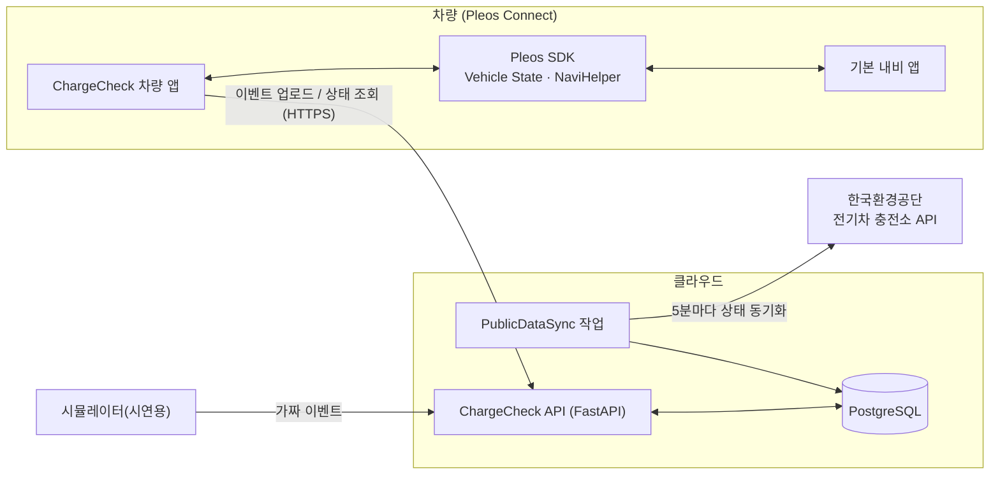
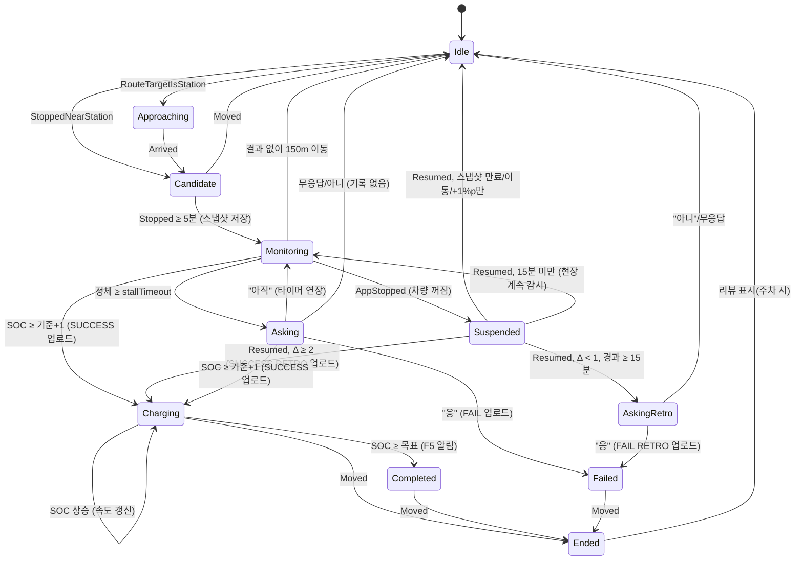
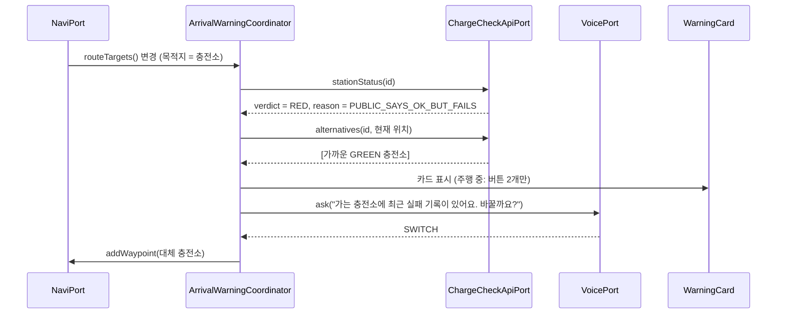
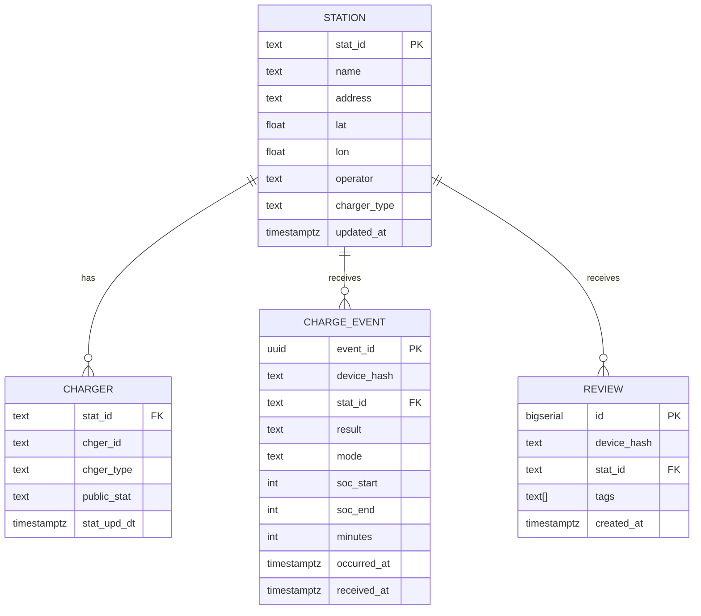
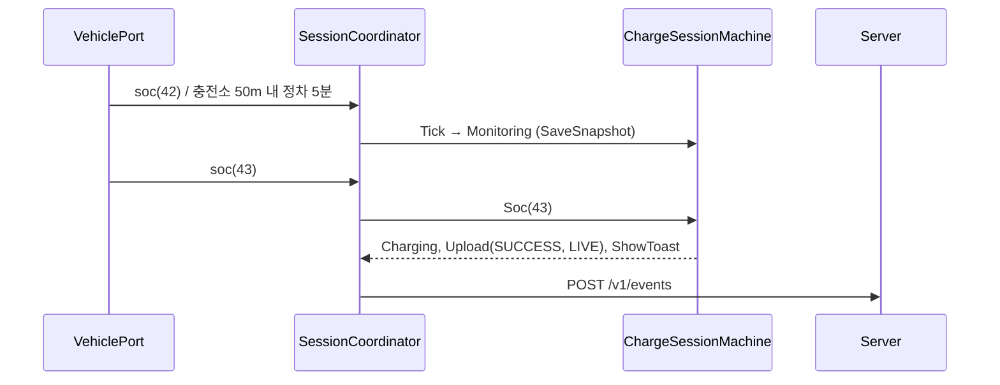
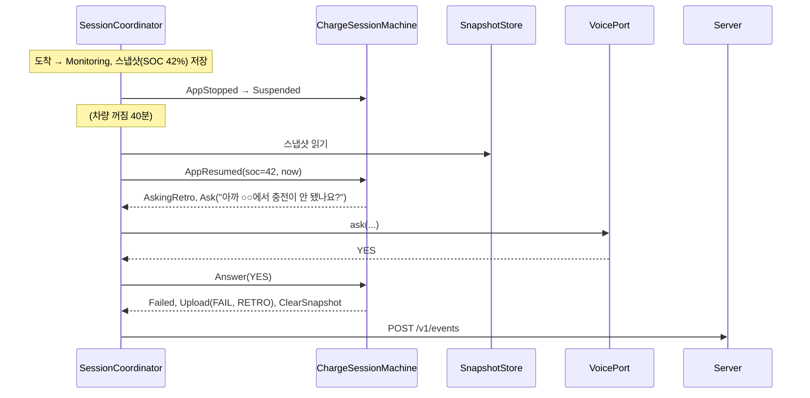

# ChargeCheck (차지체크) — 앱 아키텍처 명세

> 이 문서는 사람과 AI 코딩 도구가 그대로 따라 구현할 수 있도록 쓴 **단일 기준 문서(Single Source of Truth)** 입니다.
> 모든 이름(모듈, 클래스, 이벤트, API 경로, DB 컬럼, 설정값)은 이 문서에 적힌 그대로 사용합니다.
> 확인되지 않은 사실은 `⚠️ UNVERIFIED`로 표시했습니다. 구현 중 사실이 확인되면 이 문서를 먼저 고치세요.
>
> 작성일: 2026-10-24 · 대상: 현대자동차그룹 차량용 앱 개발 공모전 (Pleos Connect)
>
> **파일 위치**: 이 문서는 `기획문서/앱구조_명세서_AI용.md`에 있다. 이 문서에 나오는 코드 경로(`android/`, `server/`, `tools/`)는 모두 프로젝트 최상위의 `chargecheck/` 폴더 아래 경로다. 예: `android/feature/session` = `chargecheck/android/feature/session`. 코드 폴더 경로에는 한글을 쓰지 않는다(Windows에서 Gradle 테스트가 실패함).

---

## 0. AI 에이전트를 위한 요약

- **무엇**: Pleos Connect(Android Automotive OS 기반 현대차그룹 인포테인먼트)용 차량 앱 + 백엔드 서버.
- **핵심 아이디어**: 전기차가 충전소에서 **배터리 잔량(SOC)이 실제로 올랐는지**로 충전 성공/실패를 자동 기록하고, 그 기록을 모아 다음 운전자에게 "이 충전소 지금 실제로 되나요?"를 알려준다.
- **구성 요소 3개**
  1. `android/` — 차량 앱 (Kotlin, Jetpack Compose, Hilt, Coroutines/Flow, Room, DataStore)
  2. `server/` — 백엔드 (Python 3.12, FastAPI, SQLAlchemy 2, PostgreSQL 16, APScheduler)
  3. `tools/simulator/` — 여러 대의 가짜 차량이 서버에 기록을 보내는 시뮬레이터 (Python)
- **가장 중요한 설계 원칙**
  1. 기능 코드는 Pleos SDK를 직접 import하지 않는다. 모든 외부 의존성은 `core:port` 인터페이스 뒤에 숨긴다.
  2. 충전 판단 로직은 **순수 함수 상태 머신**(`ChargeSessionMachine.reduce`)이다. 부수 효과는 `Effect`로 반환한다.
  3. 충전 중에 차량(인포테인먼트)이 꺼져 있을 수 있다. 그래서 **실시간 감지(LIVE)** 와 **도착/출발 비교(RETRO)** 두 경로를 모두 구현한다.
  4. 잔량만으로 "고장"을 확정하지 않는다. 실패 기록은 **반드시 운전자 확인 1회** 후에만 남긴다. 성공 기록은 자동.
  5. 서버에는 좌표를 보내지 않는다. 충전소 ID·결과·시각·SOC만 보낸다. 기기 ID는 앱 설치 시 생성한 임의 UUID.
- **빌드 변형(flavor)**: `real`(Pleos/Android 어댑터) / `demo`(가짜 어댑터 + 시나리오 재생). 시연 영상은 `demo`로 찍는다.

---

## 1. 용어

| 용어 | 뜻 |
| --- | --- |
| SOC | State of Charge. 구동 배터리 잔량(%) |
| 충전소(Station) | 공공 API의 `statId` 하나. 여러 충전기를 가진 장소 |
| 충전기(Charger) | 공공 API의 `statId` + `chgerId` 조합 |
| 세션(ChargeSession) | 한 충전소에 도착해서 떠날 때까지 한 번의 충전 시도 |
| LIVE 판정 | 차량이 켜진 채로 SOC 변화를 실시간으로 보고 판정 |
| RETRO 판정 | 도착 시 저장한 SOC와 다음 시동 시 SOC를 비교해 사후 판정 |
| Verdict | 충전소의 종합 상태: `GREEN`/`YELLOW`/`RED`/`GRAY` |
| 이벤트(ChargeEvent) | 서버로 보내는 성공/실패 기록 1건 |

---

## 2. 기능 목록과 우선순위

| ID | 기능 | 우선순위 | 완료 기준(Acceptance) |
| --- | --- | --- | --- |
| F1 | 자동 정상 기록 | P0 | LIVE: 온사이트 후 SOC가 기준 대비 `SUCCESS_DELTA_LIVE_PCT` 이상 오르면 SUCCESS 이벤트 1건 업로드. RETRO: 재시동 시 SOC 상승폭 ≥ `SUCCESS_DELTA_RETRO_PCT`면 SUCCESS(mode=RETRO) 1건 업로드 |
| F2 | 고장 확인 후 기록 | P0 | SOC 정체가 `stallTimeout(chargerType)` 이상이면 질문. "응"이면 FAIL 1건, "아직"이면 타이머 연장, 무응답이면 기록 없음. RETRO도 동일 질문(과거형) |
| F3 | 도착 전 경고 | P0 | 내비 목적지/경유지가 충전소이고 Verdict가 YELLOW/RED면 음성+카드로 알림. "바꿔줘"면 대체 충전소를 경유지로 추가 |
| F4 | 태그 평가 | P1 | 주차 상태에서만, 세션 종료 시 태그 선택(선택 사항). 서버에 리뷰 업로드 |
| F5 | 충전 완료 알림 | P2 | LIVE 중 SOC ≥ 목표치면 알림 1회 |
| F0 | 첫 실행 동의 | P0 | 데이터 수집 동의 전에는 업로드하지 않음 |
| DEV | 데모 메뉴 | P0(demo) | `demo` flavor에서 시나리오 선택·재생 |

---

## 3. 시스템 구성



---

## 4. 차량 앱 (`android/`)

### 4.1 기술 스택

| 항목 | 선택 | 비고 |
| --- | --- | --- |
| 언어 | Kotlin 2.x | |
| 최소/컴파일 SDK | minSdk 28, compileSdk 34 | Pleos 시작 가이드 기준 |
| 빌드 | Gradle 8.x, Kotlin DSL, version catalog | |
| UI | Jetpack Compose (Material3) | Pleos UI 디자인 가이드의 버튼 크기 준수 |
| DI | Hilt | flavor별 어댑터 바인딩 |
| 비동기 | Coroutines + Flow | SDK 콜백은 `callbackFlow`로 감싼다 |
| 로컬 저장 | Room(세션·업로드 큐), DataStore(설정·스냅샷) | |
| 네트워크 | Retrofit + OkHttp + kotlinx.serialization | |
| 백그라운드 | Foreground Service(`ChargeCheckService`) | 앱이 화면에 없어도 SOC·내비 이벤트 수신 |
| 테스트 | JUnit5, kotlinx-coroutines-test, Turbine | 상태 머신은 100% 단위 테스트 |
| Pleos SDK | `ai.pleos.playground:Vehicle:2.3.1`, `ai.pleos.playground:NaviHelper:3.0.5` | Maven: `https://nexus-playground.pleos.ai/repository/maven-releases/` |

### 4.2 Gradle 모듈 구조

```text
android/
├─ app/                         # MainActivity, Compose NavHost, Hilt 진입점, ChargeCheckService
├─ core/
│  ├─ model/                    # 순수 데이터 클래스 (안드로이드 의존 없음)
│  ├─ port/                     # 외부 의존 인터페이스 (VehiclePort 등)
│  ├─ config/                   # ChargeCheckConfig (모든 임계값)
│  └─ data/                     # Room DB, DataStore, Repository, UploadQueue
├─ feature/
│  ├─ session/                  # F1·F2: ChargeSessionMachine(순수) + SessionCoordinator
│  ├─ warning/                  # F3: ArrivalWarningCoordinator
│  ├─ review/                   # F4: ReviewViewModel
│  └─ complete/                 # F5: CompletionNotifier
├─ ui/                          # Compose 화면과 디자인 컴포넌트
├─ adapter/
│  ├─ pleos/                    # Pleos Vehicle·NaviHelper 구현 (real flavor)
│  ├─ android/                  # Android TTS·STT·Location·CarUxRestrictions 구현 (real flavor)
│  ├─ remote/                   # Retrofit ChargeCheckApi 구현
│  └─ fake/                     # 가짜 구현 + ScenarioPlayer (demo flavor, 테스트)
└─ gradle/libs.versions.toml
```

**의존 규칙 (반드시 지킴)**

```text
core:model  ← (아무것도 의존하지 않음)
core:port   → core:model
core:config → core:model
core:data   → core:model, core:port, core:config
feature:*   → core:*            (adapter:* 금지, Pleos SDK 금지)
ui          → core:*, feature:*
adapter:*   → core:model, core:port   (feature:* 금지)
app         → 전부 (DI 조립만 담당)
```

### 4.3 패키지 이름

`com.chargecheck.<module>` 형식. 예: `com.chargecheck.feature.session`, `com.chargecheck.adapter.pleos`.

### 4.4 도메인 모델 (`core:model`)

```kotlin
package com.chargecheck.core.model

import java.time.Instant

@JvmInline value class StationId(val value: String)        // 공공 API statId
@JvmInline value class DeviceId(val value: String)         // 설치 시 생성한 UUID

data class GeoPoint(val lat: Double, val lon: Double)

enum class ChargerType { FAST, SLOW, UNKNOWN }

data class Station(
    val id: StationId,
    val name: String,
    val location: GeoPoint,
    val chargerType: ChargerType,       // 충전소 안에 급속이 하나라도 있으면 FAST
)

enum class Verdict { GREEN, YELLOW, RED, GRAY }

data class StationStatus(
    val stationId: StationId,
    val verdict: Verdict,
    val reasonCode: ReasonCode,
    val lastSuccessAt: Instant?,
    val recentFailCount: Int,           // 마지막 SUCCESS 이후 서로 다른 기기의 FAIL 수
    val publicAvailable: Int?,          // 공공 API 기준 사용 가능 충전기 수
    val publicTotal: Int?,
    val topTags: List<ReviewTag>,
)

enum class ReasonCode {
    RECENT_SUCCESS,                     // GREEN
    FAIL_AFTER_SUCCESS,                 // YELLOW
    MULTI_FAIL,                         // RED
    PUBLIC_OUT_OF_SERVICE,              // RED (공공 API 운영중지·점검)
    PUBLIC_SAYS_OK_BUT_FAILS,           // RED, 차별화 메시지
    NO_RECENT_DATA,                     // GRAY
}

enum class ChargeResult { SUCCESS, FAIL }
enum class DetectMode { LIVE, RETRO }

data class ChargeEvent(
    val eventId: String,                // UUID, 서버 멱등성 키
    val deviceId: DeviceId,
    val stationId: StationId,
    val result: ChargeResult,
    val mode: DetectMode,
    val socStart: Int,
    val socEnd: Int,
    val minutes: Int,
    val occurredAt: Instant,
)

enum class ReviewTag { CABLE_SHORT, SPACE_NARROW, HAS_ROOF, SLOW_SPEED, PAYMENT_ISSUE, BLOCKED_BY_CAR }

data class SocSample(val pct: Int, val at: Instant)

/** 시동이 꺼져도 남는 도착 스냅샷 (DataStore에 저장) */
data class ArrivalSnapshot(
    val stationId: StationId,
    val stationName: String,
    val chargerType: ChargerType,
    val soc: Int,
    val at: Instant,
    val location: GeoPoint?,
)
```

### 4.5 포트 인터페이스 (`core:port`)

```kotlin
package com.chargecheck.core.port

interface VehiclePort {
    /** 배터리 잔량(%) 변화 스트림. Pleos: EvBattery.registerEvBatteryStateOfCharge */
    fun soc(): Flow<SocSample>
    suspend fun currentSoc(): Int?
    /** 목표 충전량(%) — 없으면 null. ⚠️ UNVERIFIED: Pleos에서 읽기 API 존재 여부 */
    suspend fun chargeTargetPct(): Int?
}

interface DrivingStatePort {
    /** true = 주차/정차(화면 조작 허용), false = 주행(제한). Android CarUxRestrictions 기반 */
    fun isParked(): Flow<Boolean>
}

interface NaviPort {
    /** 기본 내비의 목적지·경유지 변화 */
    fun routeTargets(): Flow<List<RouteTarget>>
    /** 목적지·경유지 도착 */
    fun arrivals(): Flow<RouteTarget>
    suspend fun addWaypoint(target: RouteTarget): Result<Unit>
}
data class RouteTarget(val name: String, val location: GeoPoint, val poiId: String?)

interface LocationPort {
    fun locations(): Flow<GeoPoint>
    suspend fun lastKnown(): GeoPoint?
}

interface VoicePort {
    suspend fun say(text: String)
    /** 인식 결과를 Intent로 분류. 타임아웃·오류는 null */
    suspend fun ask(question: String, timeoutSec: Int): VoiceIntent?
}
enum class VoiceIntent { YES, WAIT, NO, SWITCH, KEEP }

interface ChargeCheckApiPort {
    suspend fun postEvent(event: ChargeEvent): Result<Unit>
    suspend fun stationStatus(id: StationId): Result<StationStatus>
    suspend fun nearbyStations(at: GeoPoint, radiusM: Int): Result<List<Station>>
    suspend fun alternatives(id: StationId, at: GeoPoint): Result<List<Pair<Station, StationStatus>>>
    suspend fun postReview(stationId: StationId, tags: List<ReviewTag>): Result<Unit>
}

interface ClockPort { fun now(): Instant }
```

### 4.6 설정값 (`core:config`)

```kotlin
// 구현: chargecheck/android/core/config/.../ChargeCheckConfig.kt
data class ChargeCheckConfig(
    val onsiteRadiusM: Int = 50,                          // 충전소 좌표에서 이 거리 안이면 '현장'
    val onsiteMinStop: Duration = Duration.ofMinutes(5),  // 이만큼 정차해야 세션 시작
    val leftRadiusM: Int = 150,                           // 이만큼 벗어나면 세션 종료
    val successDeltaLivePct: Int = 1,                     // LIVE: 기준 대비 +1%p면 성공
    val successDeltaRetroPct: Int = 2,                    // RETRO: 재시동 시 +2%p 이상이면 성공
    val stallTimeoutFast: Duration = Duration.ofMinutes(10),  // 급속: 이만큼 SOC 정체면 질문
    val stallTimeoutSlow: Duration = Duration.ofMinutes(40),  // 완속·미상: 길게
    val waitExtension: Duration = Duration.ofMinutes(10),     // "아직 연결 중" 답하면 연장
    val retroMinElapsed: Duration = Duration.ofMinutes(15),   // RETRO 실패 질문 최소 경과
    val retroMaxElapsed: Duration = Duration.ofHours(24),     // 이보다 오래되면 스냅샷 폐기
    val socRetryInterval: Duration = Duration.ofMinutes(1),   // SOC 미확인 시 재확인 간격
    val askTimeoutSec: Int = 8,
    val dedupWindow: Duration = Duration.ofHours(2),      // 서버와 동일
    val greenWindow: Duration = Duration.ofHours(3),      // 서버 판정 규칙과 동일
    val grayWindow: Duration = Duration.ofHours(24),
) {
    fun stallTimeout(type: ChargerType): Duration
    companion object { val DEFAULT: ChargeCheckConfig }
}
```

모든 임계값은 이 클래스에서만 읽는다. 숫자를 코드 곳곳에 하드코딩하지 않는다. 테스트에서 값을 바꿔 끼울 수 있도록 data class로 둔다.

### 4.7 충전 세션 상태 머신 (`feature:session`) — 핵심



**구현 형태 (순수 함수)** — 구현: `chargecheck/android/feature/session/.../SessionTypes.kt`, `ChargeSessionMachine.kt`

```kotlin
package com.chargecheck.feature.session

sealed interface SessionState {
    data object Idle : SessionState
    data class Approaching(val station: Station) : SessionState
    data class Candidate(val station: Station, val stoppedAt: Instant, val lastSoc: SocSample? = null) : SessionState
    data class Monitoring(val snap: ArrivalSnapshot, val lastSoc: SocSample, val stallDeadline: Instant) : SessionState
    data class Asking(val snap: ArrivalSnapshot, val lastSoc: SocSample) : SessionState
    data class Charging(val snap: ArrivalSnapshot, val lastSoc: SocSample) : SessionState  // snap.successSent = true
    data class Completed(val snap: ArrivalSnapshot) : SessionState
    data class Failed(val snap: ArrivalSnapshot) : SessionState
    data class Suspended(val snap: ArrivalSnapshot) : SessionState
    data class AskingRetro(val snap: ArrivalSnapshot, val currentSoc: Int, val resumedAt: Instant) : SessionState
    data class Ended(val snap: ArrivalSnapshot, val result: ChargeResult?) : SessionState
}

sealed interface SessionInput {
    data class RouteTargetIsStation(val station: Station) : SessionInput
    data class StoppedNearStation(val station: Station, val at: Instant) : SessionInput
    data class Arrived(val station: Station, val at: Instant) : SessionInput
    data class Moved(val distanceFromStationM: Int) : SessionInput
    data class Soc(val sample: SocSample) : SessionInput
    data class Tick(val now: Instant) : SessionInput
    data class Answer(val intent: VoiceIntent?, val at: Instant) : SessionInput   // null = 무응답
    data object AppStopped : SessionInput
    data class AppResumed(val soc: Int?, val location: GeoPoint?, val now: Instant) : SessionInput
    data class TargetReached(val pct: Int) : SessionInput
    data object ReviewDone : SessionInput
}

sealed interface Effect {
    data class SaveSnapshot(val snap: ArrivalSnapshot) : Effect
    data object ClearSnapshot : Effect
    data class Upload(val event: ChargeEvent) : Effect
    data class Ask(val question: String, val retro: Boolean) : Effect
    data class Say(val text: String) : Effect
    data class ShowToast(val text: String) : Effect
    data class ScheduleTick(val at: Instant) : Effect
    data object NotifyComplete : Effect
    data class OfferReview(val stationId: StationId) : Effect
}

data class Transition(val state: SessionState, val effects: List<Effect> = emptyList())

fun interface IdFactory { fun newEventId(): String }   // core:port

class ChargeSessionMachine(
    private val deviceId: DeviceId,
    private val ids: IdFactory,
    private val cfg: ChargeCheckConfig = ChargeCheckConfig.DEFAULT,
) {
    fun reduce(state: SessionState, input: SessionInput): Transition
}
```

`ArrivalSnapshot`에는 `successSent: Boolean`이 있다. 앱이 꺼졌다 켜져도 같은 세션에서 SUCCESS를 두 번 보내지 않기 위해 스냅샷과 함께 저장한다.

**전이 규칙 표 (테스트 케이스와 1:1 대응)**

| # | 현재 상태 | 입력 | 조건 | 다음 상태 | Effect |
| --- | --- | --- | --- | --- | --- |
| T1 | Idle | RouteTargetIsStation | — | Approaching | — |
| T2 | Idle/Approaching | StoppedNearStation / Arrived | 거리 ≤ 50m | Candidate | ScheduleTick(+5분) |
| T3 | Candidate | Tick | 정차 ≥ 5분, SOC 읽힘 | Monitoring | SaveSnapshot, ScheduleTick(stallDeadline). SOC 아직 없으면 ScheduleTick(+1분) |
| T4 | Candidate | Moved | > 50m | Idle | — |
| T5 | Monitoring | Soc | pct ≥ snap.soc + 1 | Charging (snap.successSent=true) | Upload(SUCCESS, LIVE), SaveSnapshot(successSent=true), ShowToast |
| T6 | Monitoring | Tick | now ≥ stallDeadline | Asking | Ask("충전이 안 되나요?", retro=false) |
| T7 | Asking | Answer(YES) | — | Failed | Upload(FAIL, LIVE), ClearSnapshot, Say("기록했어요. 다른 충전소를 찾아볼까요?") |
| T8 | Asking | Answer(WAIT) | — | Monitoring | ScheduleTick(answer.at + 10분) |
| T9 | Asking | Answer(null/NO) | — | Idle | ClearSnapshot |
| T10 | Monitoring/Asking/Charging/Completed | AppStopped | — | Suspended | (스냅샷은 이미 저장됨) |
| T11 | Suspended | AppResumed | 경과 ≤ 24h, 거리 ≤ 150m 또는 위치 미상, soc − snap.soc ≥ 2 | Charging | Upload(SUCCESS, RETRO), SaveSnapshot(successSent=true), ShowToast |
| T12 | Suspended | AppResumed | 경과 ≥ 15분, soc − snap.soc < 1 | AskingRetro | Ask("아까 ○○에서 충전이 안 됐나요?", retro=true) |
| T13 | Suspended | AppResumed | 경과 > 24h, 150m 넘게 이동, SOC 미상 | Idle | ClearSnapshot |
| T13b | Suspended | AppResumed | 경과 < 15분, SOC 상승 < 2 | Monitoring | ScheduleTick(now + stallTimeout) (현장에서 계속 지켜봄) |
| T13c | Suspended | AppResumed | 경과 ≥ 15분, SOC +1%p만 | Idle | ClearSnapshot (판단 보류) |
| T14 | AskingRetro | Answer(YES) | — | Failed | Upload(FAIL, RETRO), ClearSnapshot |
| T15 | AskingRetro | Answer(null/NO) 또는 150m 넘게 이동 | — | Idle | ClearSnapshot |
| T16 | Charging | Soc | — | Charging | (lastSoc 갱신) |
| T17 | Charging | TargetReached | — | Completed | NotifyComplete |
| T18 | Charging/Completed/Failed | Moved | > 150m | Ended | OfferReview(주차 시에만 UI가 표시) |
| T19 | Ended | ReviewDone (또는 다른 입력) | — | Idle (다른 입력이면 Idle에서 이어서 처리) | ClearSnapshot |
| T20 | Suspended | AppResumed | snap.successSent = true | Charging | Upload 없음 — 같은 세션에서 두 번째 SUCCESS 금지 |
| T21 | Asking | Soc | pct ≥ snap.soc + 1 | Charging | T5와 같음 (질문 중 충전 시작) |
| T22 | Monitoring/Asking | Moved | > 150m | Idle | ClearSnapshot (결과 없이 떠남, 기록 안 함) |

`SessionCoordinator`(Android 쪽)는 포트의 Flow를 `SessionInput`으로 바꿔 `reduce`에 넣고, 나온 `Effect`를 실행한다. 상태는 `StateFlow<SessionState>`로 UI에 노출한다.

### 4.8 충전소 판별 (`StationResolver`)

1. 내비 목적지·경유지(`RouteTarget`)가 서버 충전소 목록의 어떤 충전소와 100m 이내면 그 충전소 (1순위).
2. 아니면 `LocationPort.lastKnown()` 기준 반경 `ONSITE_RADIUS_M` 안의 충전소. 지하 주차장 대비 "마지막으로 GPS가 잡힌 위치"를 쓴다.
3. 후보가 2개 이상이면 주차 상태에서 목록으로 고르게 하고, 주행 중이면 기록하지 않는다.
4. 후보가 없으면 세션을 시작하지 않는다.

충전소 목록은 `nearbyStations(at, 500)`로 받아 Room에 캐시한다(TTL 24h).

### 4.9 도착 전 경고 (`feature:warning`, F3)



- 경고는 목적지가 바뀔 때 1회, 도착 5km 전 1회(재조회)만. 반복 알림 금지.
- GREEN이면 말하지 않고 홈 카드만 갱신한다.

### 4.10 화면 (`ui`)

| 화면 | 언제 | 주행 중 허용 | 구성 |
| --- | --- | --- | --- |
| `ConsentScreen` | 최초 실행 | ✕ | 수집 항목(충전소 ID, 결과, SOC, 시각), 동의 버튼 |
| `HomeScreen` | 앱 열기 | 제한(읽기만) | 차 일러스트 + 상태 한 줄, 목적지 충전소 카드, 최근 기록 3개 |
| `WarningCard` | F3 | ○ (버튼 2개) | 상태 배지, 충전소 이름, 이유 한 줄, [근처 충전소로 바꾸기] [그대로] |
| `ChargingScreen` | Monitoring/Charging | ✕(주차 전용) | SOC 막대, 10분당 상승폭, "정상 1건 기록" 토스트 |
| `AskSheet` | Asking/AskingRetro | ✕(주차 전용) | 질문 + [응, 안 돼요] [아직 연결 중] / 과거형 [응] [아니요] |
| `ReviewSheet` | Ended + 주차 | ✕ | 태그 칩 6개, 건너뛰기 |
| `DevMenuScreen` | demo flavor | ✕ | 시나리오 목록, 재생/정지, 시간 배속 |

- 상태 색: GREEN=초록, YELLOW=노랑, RED=빨강, GRAY=회색. 다른 곳에 색을 쓰지 않는다.
- 주행 제한은 `DrivingStatePort.isParked()`로 판단하고, 제한 중에는 키보드·긴 글·목록 스크롤을 숨긴다(Pleos 주행 규제 가이드).

### 4.11 음성 (`VoicePort`)

| 질문 | YES로 분류 | WAIT | NO | SWITCH | KEEP |
| --- | --- | --- | --- | --- | --- |
| 충전이 안 되나요? | 응, 네, 안 돼, 고장 | 아직, 잠깐, 연결 중 | 아니, 돼 | — | — |
| 아까 충전 안 됐나요? | 응, 네, 안 됐어 | — | 아니, 됐어 | — | — |
| 바꿀까요? | — | — | — | 응, 바꿔, 바꿔줘 | 아니, 그대로 |

- 인식 실패·타임아웃은 `null`(= 무응답). 무응답은 절대 FAIL로 기록하지 않는다.
- 화면 버튼은 항상 함께 띄운다(음성이 안 되는 환경 대비).

### 4.12 로컬 저장 (`core:data`)

| 저장소 | 내용 |
| --- | --- |
| DataStore `settings` | `deviceId`, `consentGiven`, `voiceEnabled` |
| DataStore `snapshot` | `ArrivalSnapshot?` (시동 꺼짐 대비, 상태 머신 Effect로만 쓰기) |
| Room `upload_queue` | 업로드 실패한 `ChargeEvent`/리뷰. 네트워크 복구 시 재시도(지수 백오프, 최대 24h) |
| Room `station_cache` | `Station` + 마지막 `StationStatus`, TTL 24h |
| Room `session_log` | 최근 세션 20건 (홈 화면 '최근 기록') |

### 4.13 권한 (AndroidManifest)

```xml
<uses-permission android:name="pleos.car.permission.CAR_ENERGY" />        <!-- EvBattery SOC -->
<uses-permission android:name="pleos.car.permission.NAVI_ROUTE" />        <!-- 목적지·이벤트 조회 -->
<uses-permission android:name="pleos.car.permission.NAVI_ROUTE_SEARCH" /> <!-- 경유지 추가 -->
<uses-permission android:name="android.permission.ACCESS_FINE_LOCATION" />
<uses-permission android:name="android.permission.RECORD_AUDIO" />
<uses-permission android:name="android.permission.INTERNET" />
<uses-permission android:name="android.permission.FOREGROUND_SERVICE" />
<uses-permission android:name="android.permission.POST_NOTIFICATIONS" />
```

### 4.14 어댑터 매핑 (`adapter:*`)

| 포트 | real flavor 구현 | 사용하는 실제 API | demo flavor 구현 |
| --- | --- | --- | --- |
| VehiclePort | `PleosVehicleAdapter` | `Vehicle(context).initialize()`, `getEvBattery()` → `registerEvBatteryStateOfCharge`, `getEvBatteryStateOfCharge` | `FakeVehicle` |
| DrivingStatePort | `CarUxRestrictionsAdapter` | Android `CarUxRestrictionsManager` | `FakeDrivingState` |
| NaviPort | `PleosNaviAdapter` | `NaviHelper.initialize`, `NaviHelperEventListener.onDestinationChanged/onDestinationArrived/onWayPointArrived/onDestinationInfo`, `addWaypoint` | `FakeNavi` |
| LocationPort | `AndroidLocationAdapter` (+ NaviHelper `onCurrentLocationInfo` 보조) | `LocationManager` | `FakeLocation` |
| VoicePort | `AndroidVoiceAdapter` | `android.speech.tts.TextToSpeech`, `SpeechRecognizer` (ko-KR) | `FakeVoice`(시나리오의 답 사용) |
| ChargeCheckApiPort | `RemoteApiAdapter` | Retrofit → §5 API | `RemoteApiAdapter`(시연용 서버) 또는 `FakeApi` |

- `EvBattery`의 정확한 메서드 시그니처·콜백 형식은 로그인 후 API Reference에서 확인한다. ⚠️ UNVERIFIED
- `getEvChargeSwitchState`는 사용하지 않는다. AAOS 표준의 `EV_CHARGE_SWITCH`는 "사용자가 요청한 충전 시작·중지 설정"이며 실제 충전 상태가 아니다.
- 표준 AAOS `EV_CHARGE_STATE`·`EV_CHARGE_PORT_CONNECTED`를 일반 앱이 읽을 수 있다면 `VehiclePort`에 `chargeState()`를 추가해 정체 판정을 보강한다. ⚠️ UNVERIFIED
- Pleos TTS/STT/FusedLocation SDK가 열리면 해당 어댑터만 교체한다.

### 4.15 시나리오 재생 (demo)

`adapter/fake/src/main/assets/scenarios/*.json`

```json
{
  "id": "live_fail_then_switch",
  "title": "LIVE: 급속 충전기 고장 → 질문 → 실패 기록",
  "station": { "id": "ME000001", "name": "○○ 급속충전소", "lat": 37.4979, "lon": 127.0276, "type": "FAST" },
  "speed": 60,
  "steps": [
    { "t": 0,   "type": "route_target", "stationId": "ME000001" },
    { "t": 30,  "type": "arrive" },
    { "t": 30,  "type": "soc", "pct": 42 },
    { "t": 30,  "type": "parked", "value": true },
    { "t": 1500,"type": "answer", "intent": "YES" }
  ]
}
```

필수 시나리오 6개: `live_success`, `live_fail_then_switch`, `live_wait_then_success`, `retro_success`, `retro_fail`, `warning_red_switch`.
`t`는 시뮬레이션 초, `speed`는 배속. `ScenarioPlayer`가 `FakeClock`과 각 Fake 포트에 값을 흘려보낸다.

---

## 5. 서버 (`server/`)

### 5.1 기술 스택

Python 3.12, FastAPI, Pydantic v2, SQLAlchemy 2 + Alembic, PostgreSQL 16, APScheduler(동기화 작업), httpx, pytest. 배포는 Docker 1개 컨테이너 + 관리형 PostgreSQL.

```text
server/
├─ app/
│  ├─ main.py               # FastAPI 앱, 라우터 등록
│  ├─ config.py             # 환경변수 (DATABASE_URL, PUBLIC_API_KEY, ...)
│  ├─ db.py                 # 엔진, 세션
│  ├─ models.py             # SQLAlchemy 테이블
│  ├─ schemas.py            # Pydantic 요청/응답
│  ├─ routers/{events,stations,reviews}.py
│  ├─ services/verdict.py   # 순수 함수 compute_verdict()
│  ├─ services/geo.py       # 거리 계산(haversine)
│  └─ jobs/public_sync.py   # 한국환경공단 API 동기화
├─ alembic/
├─ tests/
└─ Dockerfile
```

### 5.2 REST API

모든 요청 헤더: `X-Device-Id: <uuid>`, `X-App-Version: 1.0.0`. 응답은 JSON, 시각은 ISO-8601 UTC.

| 메서드 | 경로 | 요청 | 응답 |
| --- | --- | --- | --- |
| POST | `/v1/events` | `ChargeEventIn` | `202 {"accepted": true}` / 중복이면 `200 {"accepted": false, "reason": "DUPLICATE"}` |
| GET | `/v1/stations/{stationId}/status` | — | `StationStatusOut` |
| GET | `/v1/stations/nearby?lat=&lon=&radius=500` | — | `StationOut[]` (최대 30개, 거리순) |
| GET | `/v1/stations/{stationId}/alternatives?lat=&lon=` | — | `{station: StationOut, status: StationStatusOut, distanceM: int}[]` (GREEN 우선, 최대 3개, 5km 이내) |
| POST | `/v1/reviews` | `{stationId, tags: ReviewTag[]}` | `202` |
| GET | `/healthz` | — | `200 {"ok": true}` |

```jsonc
// ChargeEventIn
{
  "eventId": "6f1c...-uuid",
  "stationId": "ME000001",
  "result": "SUCCESS",
  "mode": "LIVE",
  "socStart": 42,
  "socEnd": 47,
  "minutes": 6,
  "occurredAt": "2026-11-10T08:15:00Z"
}

// StationStatusOut
{
  "stationId": "ME000001",
  "verdict": "RED",
  "reasonCode": "PUBLIC_SAYS_OK_BUT_FAILS",
  "message": "사용 가능으로 표시되지만 최근 실제로는 충전이 안 됐어요",
  "lastSuccessAt": "2026-11-10T05:02:00Z",
  "recentFailCount": 2,
  "publicAvailable": 3,
  "publicTotal": 4,
  "topTags": ["CABLE_SHORT"]
}
```

### 5.3 데이터베이스



- `CHARGER` 기본키: (`stat_id`, `chger_id`).
- `device_hash` = SHA-256(`X-Device-Id` + 서버 솔트). 원본 기기 ID는 저장하지 않는다.
- 인덱스: `charge_event(stat_id, occurred_at desc)`, `station(lat, lon)`.
- 좌표·이동 경로는 저장하지 않는다(개인위치정보 최소화).

### 5.4 판정 규칙 `compute_verdict` (서버 단일 구현)

입력: 최근 24시간 이벤트(시간순), 공공 API 충전기 상태 목록, 현재 시각.

```text
1. public = 공공 API 요약 (available, total, allOutOfService)
2. lastSuccess = 가장 최근 SUCCESS 이벤트
3. failsAfter  = lastSuccess 이후 FAIL 이벤트의 서로 다른 device_hash 수 (lastSuccess 없으면 24h 내 전체)
4. if public.allOutOfService:                       → RED,    PUBLIC_OUT_OF_SERVICE
5. if failsAfter ≥ 2 and public.available > 0:      → RED,    PUBLIC_SAYS_OK_BUT_FAILS
6. if failsAfter ≥ 2:                               → RED,    MULTI_FAIL
7. if failsAfter == 1:                              → YELLOW, FAIL_AFTER_SUCCESS
8. if lastSuccess within GREEN_WINDOW_H(3h):        → GREEN,  RECENT_SUCCESS
9. else                                             → GRAY,   NO_RECENT_DATA
```

| reasonCode | 운전자에게 보이는 문장 |
| --- | --- |
| RECENT_SUCCESS | "{n}분 전 실제로 충전됨" |
| FAIL_AFTER_SUCCESS | "최근 충전 실패 제보 1건" |
| MULTI_FAIL | "최근 여러 차가 충전에 실패했어요" |
| PUBLIC_SAYS_OK_BUT_FAILS | "사용 가능으로 표시되지만 최근 실제로는 충전이 안 됐어요" |
| PUBLIC_OUT_OF_SERVICE | "운영사 점검·운영 중지" |
| NO_RECENT_DATA | "운영사 기준 사용 가능 {a}/{t} (실제 확인 기록 없음)" |

**중복·악용 방지**: 같은 `device_hash` + `stat_id`는 `DEDUP_WINDOW_H`(2h) 안에 이벤트 1건만 인정. 한 기기의 FAIL이 하루 10건을 넘으면 그날 FAIL은 판정에서 제외.

### 5.5 공공 데이터 동기화 (`jobs/public_sync.py`)

| 작업 | 주기 | 호출 | 비고 |
| --- | --- | --- | --- |
| 충전소·충전기 목록 전체 | 매일 04:00 | `getChargerInfo` | ⚠️ UNVERIFIED: 엔드포인트명·필드 확인 필요 |
| 상태 변경분 | 5분마다 | `GET https://apis.data.go.kr/B552584/EvCharger/getChargerStatus?serviceKey=...&period=5&dataType=JSON` | `stat`, `statUpdDt` 확인됨 |

- 상태 코드(`stat`) 값의 의미는 활용가이드 문서로 확정한다. ⚠️ UNVERIFIED. 확정 전에는 `config.py`의 `PUBLIC_STAT_MAP`(코드→AVAILABLE/CHARGING/OUT_OF_SERVICE/UNKNOWN)만 고치면 되게 한다.
- 호출 실패 시 마지막 값을 유지하고 `stat_upd_dt`로 신선도를 판단한다.

---

## 6. 시뮬레이터 (`tools/simulator/`)

- `simulate.py --server URL --station ME000001 --devices 5 --pattern broken|healthy|recovered`
- `broken`: 5대 중 3대가 FAIL → 해당 충전소 RED(PUBLIC_SAYS_OK_BUT_FAILS) 되는지 확인
- `recovered`: FAIL 2건 뒤 SUCCESS 1건 → GREEN 복귀 확인
- 시연 영상에서 "다른 차의 기록이 내 차 경고로 뜨는 장면"을 만들 때 사용

---

## 7. 핵심 흐름 시퀀스

### 7.1 LIVE 성공



### 7.2 RETRO 실패 (충전 중 차량이 꺼진 경우)



---

## 8. 구현 순서 (마일스톤)

| 단계 | 기간(목표) | 산출물 | 완료 확인 |
| --- | --- | --- | --- |
| M0 | 10/24–10/27 | Pleos 가입·프로젝트, 공공 API 키, 저장소 생성, Gradle 뼈대(모든 모듈 빈 껍데기) | `./gradlew build` 성공 |
| M1 | 10/27–10/31 | `core:model/port/config`, `ChargeSessionMachine` + 전이표 T1–T20 단위 테스트 | 테스트 20개 통과 |
| M2 | 10/28–11/04 | 서버: `/v1/events`, `/status`, `compute_verdict` + 테스트, 공공 API 동기화(픽스처로 먼저) | pytest 통과, Docker 기동 |
| M3 | 10/31–11/07 | `adapter:fake` + `ScenarioPlayer` + `DevMenuScreen`, `SessionCoordinator` | 시나리오 6개가 에뮬레이터에서 재생 |
| M4 | 11/03–11/09 | UI: Home, ChargingScreen, AskSheet, WarningCard, Consent | 스크린샷 |
| M5 | 11/05–11/11 | `adapter:pleos`(SOC, NaviHelper) 에뮬레이터 연동, Virtual Console로 SOC 변경 확인 | real flavor에서 LIVE 성공 기록 |
| M6 | 11/10–11/14 | 시뮬레이터 + 시연 영상, GitHub README, `apk/팀명_ChargeCheck_release.apk` | 1차 제출 |
| M7 | 11/16–12/02 | F3 대체 충전소, F4, 실패 재시도, 안정화 | 2차 PT용 동작 앱 |

---

## 9. 테스트 전략

- **상태 머신**: 전이표 T1–T22 각각 1개 이상 테스트(`chargecheck/android/feature/session/src/test/.../ChargeSessionMachineTest.kt`, 39개 통과). 상태 머신은 순수 함수라 고정된 `Instant`만으로 시간 경과를 표현한다.
- **판정 규칙**: `compute_verdict` 표 기반 테스트(규칙 4–9 각각).
- **계약 테스트**: Android `RemoteApiAdapter`와 서버 스키마가 같은 JSON 예시(§5.2)로 직렬화/역직렬화 되는지.
- **시나리오 테스트**: 시나리오 6개를 `demo` flavor 계측 테스트로 자동 실행.
- **수동**: 에뮬레이터 + Virtual Console에서 Energy > Battery SOC 슬라이더, Motion > Gear Selection으로 LIVE 성공/실패 확인.

---

## 10. 확인되지 않은 것 (⚠️ UNVERIFIED 모음)

| 항목 | 영향 | 대안 |
| --- | --- | --- |
| 시동이 꺼진 동안 Pleos 앱이 실행되는지 | LIVE 판정 범위 | RETRO 경로로 커버 (설계 반영됨) |
| `EvBattery` 메서드 시그니처·갱신 빈도 | 어댑터 구현 | 로그인 후 API Reference 확인 |
| 표준 AAOS `EV_CHARGE_STATE` 읽기 가능 여부 | 감지 속도 | 가능하면 `VehiclePort.chargeState()` 추가 |
| Pleos 에뮬레이터에서 Android TTS/STT/Location 동작 | 음성·위치 | 버튼 UI, NaviHelper 위치 이벤트 |
| 공공 API `stat` 코드 의미, `getChargerInfo` 필드 | 판정 | `PUBLIC_STAT_MAP` 한 곳만 수정 |
| 차량 앱의 외부 서버 통신에 대한 Pleos 심사 제약 | 서버 구조 | 10/28 설명회에서 질문 |
| 개인위치정보 관련 법적 절차(실서비스 시) | 사업화 | 좌표 미전송·해시 ID로 최소화, 법률 검토 |

---

## 11. 참고 링크

- Pleos 시작 가이드: https://document.pleos.ai/docs/pleos-only/getting-started
- Vehicle SDK 권한: https://document.pleos.ai/docs/pleos-only/connect-sdk-pleos/Vehicle/vehicle-permission
- NaviHelper 이벤트: https://document.pleos.ai/docs/pleos-only/connect-sdk-pleos/NaviHelper/event-listeners
- Virtual Console: https://document.pleos.ai/docs/pleos-only/app-test-guide/virtual-console-guide
- 주행 안전 설계: https://document.pleos.ai/docs/pleos-only/vehicle-app-planning-guide/driver-distraction-guideline
- 공공 API(충전소 정보): https://www.data.go.kr/data/15076352/openapi.do
- AAOS 차량 속성: https://developer.android.com/reference/android/car/VehiclePropertyIds
- 공모전 제출 방법: https://appdevchallenge.auto-hmg.io/guide/submission
