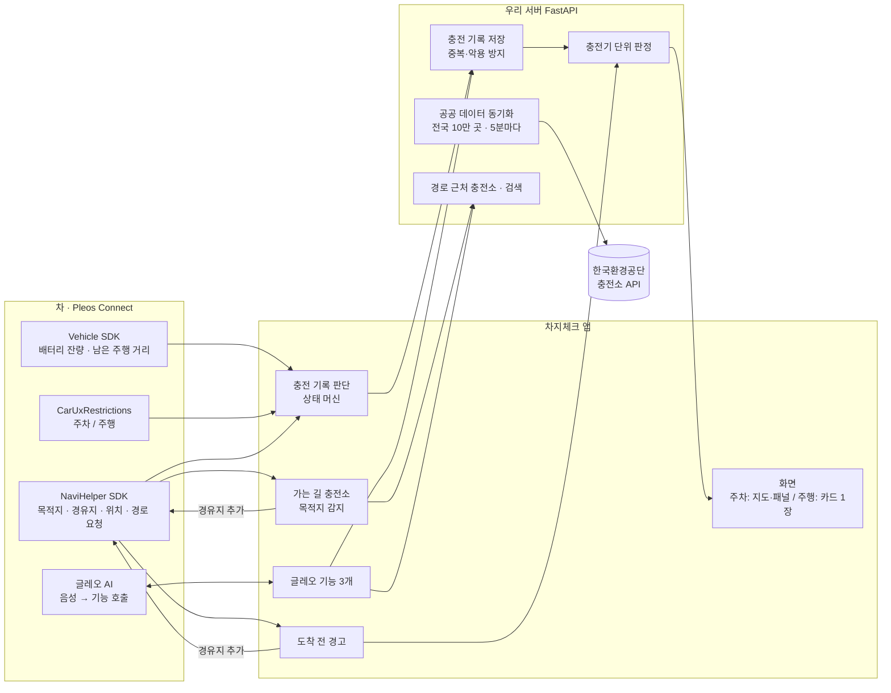
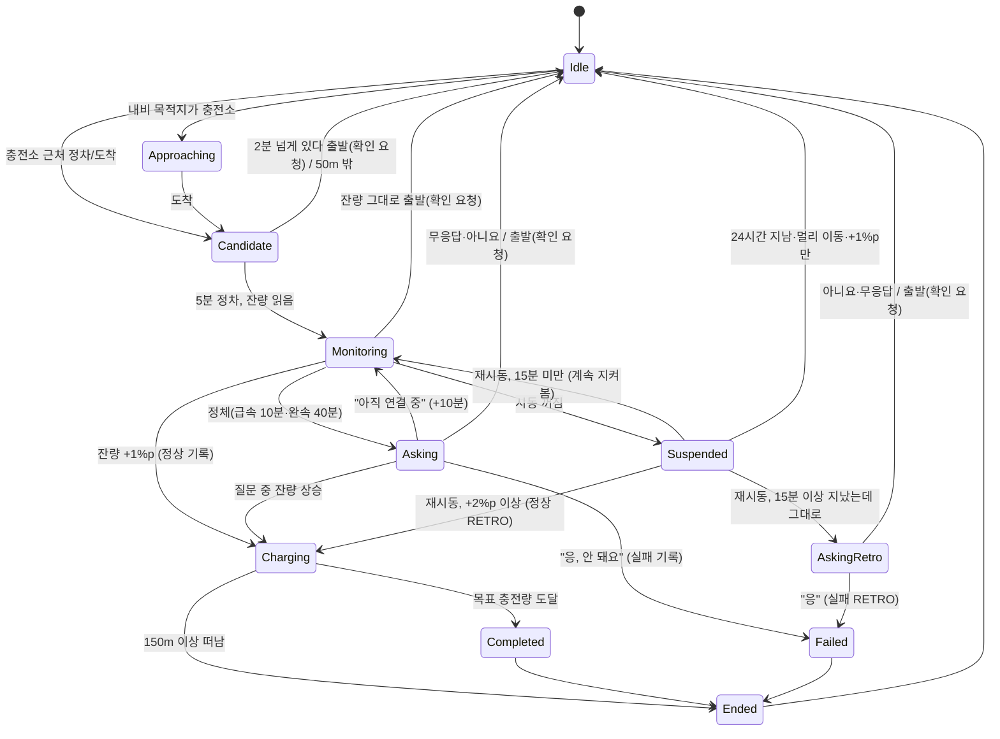

# 차지체크(ChargeCheck) 앱 구동 기획

> 현대자동차그룹 차량용 앱 개발 공모전 출품작. 2026-10-25 기준으로 **실제로 만들어져 동작하는 모습**을 정리한 기획 문서다.
> 이 폴더의 유일한 기준 문서이며, 코드 주석이 가리키는 문서도 이것이다. 코드 경로는 모두 저장소의 `chargecheck/` 아래다.
> (이전 문서 `앱구조_명세서_AI용.md`·`앱구조_다이어그램.pdf`는 이 문서로 대체되어 삭제했다. git 기록에 남아 있다.)

---

## 1. 한 줄 요약

**차가 충전할 때마다 그 충전기가 실제로 됐는지를 배터리 잔량 변화로 자동 기록하고, 같은 충전소로 가는 다음 차에게 출발 전에 알려 주는 Pleos Connect 차량용 앱.**

- 문제: 전기차 충전 불편 1위는 "가 보니 고장"(잦은 고장 52.7%, GS차지비 조사 2026.03). 운영사가 보내는 "사용 가능" 표시와 실제 충전 결과가 다르다(등록 54만대 중 상태 미확인·통신 이상 3일 이상 1만7800기, 2026.09.30 기준). 파산·경영난 사업자의 충전기 6,670기도 멈춰 있다(2026.10).
- 정부 대응과 남는 빈틈: 2026년 11월부터 충전사업자에게 **고장 내용·예상 복구 기간 제공이 의무화**된다(대기환경보전법 하위법령 개정). 그러나 이는 **운영사가 아는 고장**을 알리는 의무다. 한국환경공단도 지금 정보가 사업자 입력값이라 현장과 맞는지 검증하지 못한다고 인정했다. **운영사도 모르는 고장(표시는 '사용 가능'인데 실제로는 안 되는 충전기)은 여전히 아무도 알려 주지 않는다.**
- 해결: 사람이 제보하지 않아도 **차가 '정상'을 자동으로 쌓는다.** 실패는 운전자 확인을 한 번 받은 것만 기록한다. 실패가 쌓이면 **다음 차에게 경고하고, 운영사에게도 알린다.** 운영사가 고치면(공공 데이터 상태 복구·다른 차 충전) 자동으로 풀린다(6장 고장 신고 루프).
- 차별점: ① "실제로 충전됐다"는 사실은 차의 배터리 신호로만 알 수 있다(폰 앱은 따라 할 수 없음). ② 운전자 경고에서 끝나지 않고 **운영사 수리까지 이어지는 닫힌 고리**이며, 해결까지 걸린 시간을 잰다 — 정책 평가를 "설치 대수가 아니라 가동률·고장 대응 시간"으로 하자는 요구(디지털데일리 2026.10.24)와 같은 방향.

---

## 2. 설계 원칙

1. **확인된 기능만 필수로 쓴다.** 에뮬레이터에서 직접 확인한 Pleos 기능(배터리·주행 가능 거리·내비 목적지·주행 제한)과 우리 서버만 필수다.
2. **모르는 것은 '있으면 더 좋음'으로만 쓴다.** 글레오 음성, 내비 도착 배터리 예측, 실차 조건은 없어도 버튼과 우리 계산으로 똑같이 동작한다.
3. **운전자는 평소대로 운전한다.** 목적지는 원래처럼 내장 내비에 넣고, 앱은 그것을 알아서 읽는다. 문제가 있을 때만 끼어들고, 입력은 버튼 한 번이나 말 한마디까지.

### 편의 규칙

| 규칙 | 내용 |
| --- | --- |
| 필요할 때만 | 경로 카드는 충전이 필요할 때만, 도착 전 경고는 위험한 충전소일 때만 띄운다. 괜찮으면 조용히 있는다 |
| 때를 맞춰서 | 질문은 차가 서 있을 때만. 주행 중에는 위험 회피·충전 필요 카드만 잠깐(15~30초) 보이고 내비를 가리지 않는다 |
| 기본은 안전한 쪽 | 아무것도 안 누르면 경로도 기록도 바뀌지 않는다. 무응답은 절대 실패로 기록하지 않는다 |
| 한 번만 | 같은 경로 카드·같은 경고는 한 번 운전에 한 번, 실패 확인은 주행 중 보류하고 다음 주차 때 한 번 |
| 덜 귀찮게 | 경로 카드에 '괜찮아요'를 두 번 연속 누르면 다음부터는 정말 못 갈 때만 띄운다 |
| 고칠 수 있게 | 실패를 기록한 뒤 이유·충전기 번호를 다시 말하면(같은 충전소 2시간 안) 새로 올리지 않고 고친다 |
| 힌트 한 줄 | 카드마다 그 순간 쓸 말만 알려 준다(예: "글레오에게 '들렀다 가자'라고 해도 돼요") |

---

## 3. 전체 구성



- **차 → 앱**: 배터리 잔량(%), 남은 주행 가능 거리, 내비 목적지·경유지·남은 도로 거리·현재 위치, 주차/주행.
- **앱 → 차**: 내비에 목적지·경유지 넣기. 글레오에 대답 문장 돌려주기.
- **앱 ↔ 서버**: 충전 기록 올리기, 충전소 판정·주변 목록·경로 근처 충전소·검색 받기.
- **운전자는 앱을 열지 않아도 된다.** 시동(부팅)이 켜지면 `ChargeCheckService`(포그라운드 서비스)가 화면 없이 돌며 목적지 감지·충전 기록·도착 전 경고를 한다. 앱 화면이 안 보이면(기본 내비를 보는 중) 카드를 **내비 위 알림(헤드업)**으로 띄우고, 버튼(최대 2개)을 누르면 화면 버튼과 같은 동작을 한다(`CardNotifier`, `CardActionReceiver`). 앱을 여는 건 충전소를 자세히 보고 싶을 때뿐이다.
- **외부 지도·경로 서버는 쓰지 않는다.** 장소 검색은 내장 내비, 실제 길은 내비가 짠다. 지도 바탕(OpenStreetMap 타일)은 주차 중 지도 화면에만 쓰며, 빼도 앱은 동작한다.

### 코드 구조

```text
chargecheck/
├─ android/                       차량 앱 (Kotlin, Jetpack Compose, minSdk 28, compileSdk 36)
│  ├─ core/model                  데이터 모델 (충전소, 판정, 충전 기록, 경로 계획 …)
│  ├─ core/port                   바깥 세상 통로 인터페이스 (VehiclePort, NaviPort, ChargeCheckApiPort …)
│  ├─ core/config                 모든 임계값 (ChargeCheckConfig)
│  ├─ feature/session             충전 기록 판단: ChargeSessionMachine(순수 함수) + SessionCoordinator
│  ├─ feature/warning             도착 전 경고, 경로 카드 규칙(shouldShowRouteCard), 충전소 짝짓기(matchStation)
│  ├─ ui                          화면 (StationMapScreen, DrivingScreen, RoutePanel, 카드·시트)
│  ├─ adapter/pleos               Pleos Vehicle·NaviHelper 연결
│  ├─ adapter/android             주행 제한(CarUxRestrictions)
│  ├─ adapter/remote              우리 서버 REST
│  ├─ adapter/fake                가짜 포트 + 시나리오 재생(demo 빌드·테스트)
│  └─ app                         real 빌드: RealGraph(앱 전체 상태), ChargeCheckService·BootReceiver(백그라운드),
│                                 CardNotifier(내비 위 알림 카드), GleoActions, 화면 연결 / demo 빌드: 시나리오 화면
└─ server/                        FastAPI + SQLAlchemy (SQLite 로컬, PostgreSQL 대응)
   ├─ app/routers                 events, stations, places, reviews
   ├─ app/services                verdict(판정), status, along(경로 근처), route(거리 계산), geo
   └─ app/jobs/public_sync.py     공공 데이터 동기화
```

- 규칙: `feature`는 `core`만 안다(Pleos SDK를 직접 부르지 않음). 그래서 가짜 포트를 끼우면 차 없이 시연·테스트가 된다.
- 빌드 2종: **real**(Pleos SDK + 우리 서버), **demo**(가짜 데이터로 시나리오 6개 재생).

---

## 4. 하루 흐름 (운전자가 겪는 순서)

| 순간 | 앱이 하는 일 | 운전자 입력 |
| --- | --- | --- |
| 출발 전, 내비에 목적지 입력 | 목적지를 감지해 가는 길에 충전이 필요한지 계산. 필요하면 "12km 지점 ○○ · 40분 전 정상 · 도착 배터리 약 15%" 패널. 필요 없으면 조용히 | 0~1번 ([들렀다 가기]) |
| 패널에 답하지 않고 출발 | 주행 화면에 같은 카드 15초, 한 번만 | 0~1번 |
| 주행 중 | 목적지·경유지 충전소가 위험하면 "최근 실패 기록 · [△△로 바꾸기] [그대로]". 궁금하면 "글레오, 가는 길에 충전할 데 있어?" | 0~1번 |
| 충전소 도착·플러그 꽂기 | 배터리 잔량이 1%p 오르면 "정상 1건 남겼어요" | 없음 |
| 충전이 안 됨 | 급속 10분(완속 40분) 그대로면 "충전이 안 되나요?". 또는 "글레오, 3번 결제가 안 돼" / 상세 카드 [여기 충전 안 됐어요] | 1번 |
| 말없이 다시 출발 | 질문은 주행 중 보류. 2시간 안의 다음 주차 때 "충전이 안 됐나요? [안 됐어요] [아니요]" 한 번 | 0~1번 |
| 실패 기록 뒤 | 충전기가 2대 이상이고 번호를 모르면 "몇 번 충전기였나요?" | 0~1번 |
| 다음 차 | 같은 충전소로 가면 출발 전에 경고 | — |

---

## 5. 핵심 판단 ① 충전 기록 (feature/session)

### 원리
- 충전소에 머물며 배터리 잔량이 오르면 **정상(SUCCESS)** 을 자동으로 올린다.
- 오르지 않으면 고장일 수도, 예약 충전·완속·목표 충전량 도달·그냥 주차일 수도 있다. 그래서 **실패(FAIL)는 운전자 확인(응/안 됐어요)이 있을 때만** 올린다.
- 충전 중 시동을 끄고 자리를 비우는 경우가 많아 두 경로로 판단한다.
  - **LIVE(실시간)**: 차 안에 있을 때 잔량 변화를 바로 본다.
  - **RETRO(재시동 비교)**: 도착 때 잔량을 스냅샷으로 저장하고, 다시 켰을 때 비교한다.
  - **MANUAL(직접 표시)**: 상세 카드 버튼이나 글레오로 운전자가 직접 알린다.

### 상태 흐름



### 전이 규칙 (테스트와 1:1)

| # | 상태 | 입력 | 조건 | 다음 | 하는 일 |
| --- | --- | --- | --- | --- | --- |
| T1 | Idle | 목적지가 충전소 | — | Approaching | — |
| T2 | Idle/Approaching | 정차·도착 | 50m 안 | Candidate | 5분 뒤 확인 예약 |
| T3 | Candidate | 시간 경과 | 5분, 잔량 읽음 | Monitoring | 스냅샷 저장, 정체 시한 예약(잔량 미확인이면 1분 뒤 재확인) |
| T4 | Candidate | 이동 | 50m 밖 | Idle | — |
| T5 | Monitoring | 잔량 | +1%p | Charging | 정상(LIVE) 업로드, 알림 |
| T6 | Monitoring | 시간 경과 | 정체 시한 | Asking | "충전이 안 되나요?" |
| T7 | Asking | 응 | — | Failed | 실패(LIVE) 업로드 |
| T8 | Asking | 아직 | — | Monitoring | +10분 |
| T9 | Asking | 아니요·무응답 | — | Idle | 기록 없음 |
| T10 | Monitoring/Asking/Charging/Completed | 시동 꺼짐 | — | Suspended | (스냅샷 유지) |
| T11 | Suspended | 재시동 | 24시간 안·150m 안, +2%p 이상 | Charging | 정상(RETRO) 업로드 |
| T12 | Suspended | 재시동 | 15분 이상, 그대로 | AskingRetro | "아까 ○○에서 충전이 안 됐나요?" |
| T13 | Suspended | 재시동 | 24시간 초과·이동·잔량 모름 | Idle | 기록 없음 |
| T13b | Suspended | 재시동 | 15분 미만, +2%p 미만 | Monitoring | 현장에서 계속 지켜봄 |
| T13c | Suspended | 재시동 | 15분 이상, +1%p만 | Idle | 판단 보류 |
| T14 | AskingRetro | 응 | — | Failed | 실패(RETRO) 업로드 |
| T15 | AskingRetro | 아니요·무응답 | — | Idle | 기록 없음 |
| T16–T19 | Charging/Completed/Failed/Ended | 잔량·목표 도달·이동·리뷰 | — | — | 충전 중 갱신, 완료 알림, 떠나면 종료 |
| T20 | Suspended | 재시동 | 이미 정상을 보낸 세션 | Charging | 다시 보내지 않음(세션당 정상 1건) |
| T21 | Asking | 잔량 | +1%p | Charging | T5와 같음 |
| T22 | Monitoring/Asking/AskingRetro | 이동 | 150m 밖(주행 신호를 못 받은 경우) | Idle | 실패 확인 요청 |
| T23 | Candidate | 출발(P→D) | 2분 이상 머묾, 잔량 읽음 | Idle | 실패 확인 요청 |
| T24 | Monitoring/Asking | 출발 | — | Idle | 실패 확인 요청 |
| T25 | AskingRetro | 출발 | — | Idle | 실패 확인 요청(RETRO) |

- **실패 확인 요청(ConfirmLater)**: 상태 머신이 실패 기록을 미리 만들어 넘기면, `SessionCoordinator`가 주행 중에는 숨겨 두고 다음 주차(2시간 안)에 한 번만 묻는다. 주차 상태를 받지 않는 시연 빌드만 기존 즉시 표시 방식을 유지한다. "안 됐어요"일 때만 올린다.

### 내비 없이 충전 (충전구 신호)

집·회사처럼 늘 가는 충전소는 내비 없이 가는 경우가 많다. 그래서 **충전구가 열렸는지**(Vehicle SDK `EvBattery.registerEvChargePortOpen`)를 '충전하려 했다'는 증거로 쓴다. 충전소 근처에 그냥 주차한 차는 충전구를 안 열므로 건드리지 않는다.

| 상황 | 규칙 |
| --- | --- |
| 시작 | 주차 중 충전구 열림 + 차 위치 **80m 안** 충전소 → 가장 가까운 곳으로 기록 시작(목록에 없으면 그 위치 주변을 서버에서 받는다) |
| 성공 | 배터리 1%p 이상 상승 → 정상 기록(내비 경유와 같음) |
| 실패 | 충전구를 연 뒤 2분 넘게 있다가 잔량 그대로 출발 → "충전이 안 됐나요?" 한 번 |
| 근처 충전소가 둘(거리 차 20m 미만) | 성공은 가까운 곳으로 기록, **실패는 묻지 않는다**(엉뚱한 곳을 빨강으로 만들지 않기). 직접 표시·글레오로는 알릴 수 있다 |
| 같은 충전소에서 '아니요' 2번 | 그곳에서는 더 묻지 않는다(집·회사의 개인 충전기 등) |
| 충전구 신호를 보내는 차가 충전구를 안 열고 떠남 | 내비로 충전소에 갔어도 묻지 않는다(그냥 들른 것) |
| 충전구 신호가 없는 차 | 지금처럼 내비 경유만 기록 |

- 위치는 기기 안에서 충전소를 찾는 데만 쓰고 서버에는 충전소 ID와 결과만 보낸다.
- 에뮬레이터 확인(2026-10-26): 내비 안내를 끈 상태에서 Virtual Console "Charge Port → Open" → "경기성남 SW드림타운 2(38m)에서 시작 · 근처 충전소가 둘" → 배터리 56→58% → 내비 위 "정상 1건" 팝업. 같은 곳에서 잔량 그대로 출발하자 "확인 생략: 가까운 충전소가 둘".

### 설정값 (`core/config/ChargeCheckConfig.kt`)

| 값 | 기본 | 뜻 |
| --- | --- | --- |
| onsiteRadiusM / onsiteMinStop | 50m / 5분 | 충전소 현장 판정 |
| leftRadiusM | 150m | 떠났다고 보는 거리 |
| successDeltaLivePct / RetroPct | 1%p / 2%p | 정상 판단 기준 |
| stallTimeoutFast / Slow | 10분 / 40분 | 정체 질문까지 기다림 |
| waitExtension | 10분 | "아직" 연장 |
| retroMinElapsed / MaxElapsed | 15분 / 24시간 | 재시동 비교 범위 |
| attemptMinStop | 2분 | 이보다 짧게 들르면 출발해도 묻지 않음 |
| portRadiusM / ambiguousGapM | 80m / 20m | 충전구로 시작할 때 찾는 거리 / 두 충전소가 애매하다고 보는 거리 차 |
| confirmMuteAfterNo | 2번 | 같은 충전소에서 '아니요'가 이만큼이면 더 묻지 않음 |
| confirmDrivingShow / confirmWindow | 45초 / 2시간 | 주차 신호 없는 시연의 표시 시간 / 실제 앱의 보류 확인 유효 시간 |

디버그 빌드는 에뮬레이터 확인용으로 정차 30초, 급속 정체 2분, 출발 확인 20초로 줄인다.

---

## 6. 핵심 판단 ② 충전소 판정 (server/app/services/verdict.py)

충전소에는 충전기가 여러 대 있으므로 **충전기 단위로 먼저 판정하고 충전소로 모은다.** 충전기 한 대 고장으로 충전소 전체를 빨강으로 만들지 않는다.

| 색 | 충전소 판정 | 운전자에게 보이는 말(예) |
| --- | --- | --- |
| 초록 | 최근 3시간 안 정상 기록(우리 기록 또는 공공 데이터 '충전 중'), 그 뒤 실패 없음 | "40분 전 실제로 충전됨" / "15분 전 다른 차가 충전함(운영사 데이터)" |
| 노랑 | 일부 충전기에 실패, 1대짜리에 실패 1건, 6시간 넘은 실패, 수리됐을 수 있음 | "6대 중 1대에 최근 실패 기록" / "7시간 전 실패 제보 · 이후 확인 기록 없음" |
| 빨강 | 실패가 모든 충전기를 덮음(서로 다른 차 2대 이상) 또는 전부 운영 중지 | "사용 가능으로 표시되지만 최근 실제로는 충전이 안 됐어요" |
| 회색 | 최근 24시간 기록 없음 | "운영사 기준 사용 가능 3/4 (실제 확인 기록 없음)" |

- 충전기: 운영 중지면 빨강, 마지막 정상 뒤 서로 다른 차 실패 2건 이상이면 빨강, 1건이면 노랑, 3시간 안 정상이면 초록.
- 번호 없는 정상은 "이 충전소 어딘가에서 충전됨"이다. 충전소의 최근 성공으로 보되 **번호가 알려진 충전기의 실패는 지우지 않는다**(그 충전기가 아니었을 수 있다). 실패 기록이 없는 충전기만 초록으로 보여 준다. 번호 없는 실패는 충전기 한 대 몫으로 보수적으로 센다.
- 같은 충전기의 최근 정상 한 번이 낡은 실패를 덮는다 → 수리되면 누군가 그 충전기에서 한 번 충전하는 순간 회복.
- 악용 방지: 같은 기기·충전소는 2시간에 1건, 하루 실패 10건 넘는 기기는 판정에서 제외, 최근 24시간만 본다.
- **도착 전 경고**는 빨강, 또는 '일부 충전기만'·'수리됐을 수 있음'이 아닌 노랑일 때만 띄운다.

### 빨강이 저절로 풀리는 신호

빨간색이면 우리 사용자는 그 충전소에 가지 않는다. 그래서 **우리 사용자가 다시 시도하지 않아도 풀리게** 했다.

| 신호 | 어디서 | 판정 |
| --- | --- | --- |
| 누군가 충전 성공 | 우리 기록 | 그 전 실패를 지움 |
| 충전기가 '충전 중'으로 바뀜 | 공공 데이터(5분마다) — **우리 앱을 안 쓰는 차가 실제로 충전** | 성공과 같게 봄 → 초록 "다른 차가 충전함" |
| '점검·운영 중지 → 사용 가능' | 공공 데이터 — 운영사가 고침 | 그 전 실패를 지우고 노랑 "수리됐을 수 있음" |
| 시간 | 마지막 실패 6시간 경과 / 24시간 경과 | 빨강 → 노랑 / 사라짐 |

- 상태가 바뀐 **순간**만 신호로 쓴다(충전기 칸의 `last_charging_at`, `repaired_at`). '충전 중'으로 며칠씩 멈춰 있는 고장 표시는 24시간이 지나면 믿지 않는다.

### 고장 신고 루프 (운영사 리포트)

```text
운전자 차가 실패 기록 2건(서로 다른 차) ─▶ 고장 알림 열림(OPEN) ─▶ 운영사 웹훅·리포트 화면
                                                        │
          운영사가 점검·운영 중지로 바꿈 ◀───────────────┘  (IN_REPAIR)
                    │ 수리
                    ▼
   공공 데이터 '사용 가능'·'충전 중' 또는 누군가 충전 성공 ─▶ 자동 해결(RESOLVED) + 앱에서 빨강 해제
```

- 판정과 같은 규칙으로 움직이므로 **앱에서 빨강이 풀리는 순간 운영사 알림도 해결**된다.
- 알림에 담는 것: 충전소·충전기 번호(모르면 충전소 단위)·실패한 서로 다른 차 수·실패 이유별 건수·마지막 실패 시각. **기기 정보는 담지 않는다.**
- 해결 이유를 남긴다: 운전자 충전 성공 / 다른 차 충전 중(공공 데이터) / 운영사 상태 복구 / 기간 만료. 운영사별 **해결까지 걸린 시간(중앙값)**을 낸다.
- 운영사가 받는 방법: ① 리포트 화면 `/operator`(운영사별 필터, [확인함], CSV) ② 웹훅(`OPERATOR_WEBHOOK_URL`, 새 알림마다 JSON POST).
- 사업성과 연결: 운영사는 고장을 빨리 알면 수리가 빨라지고 이용률이 오른다. 차지체크는 **운영사가 아직 모르는 고장**(공공 데이터는 '사용 가능'인데 실제로는 안 되는 충전기)을 알려 준다 → 운영사 리포트 유료화의 근거.

### 실패 이유

| 이유 | 판정 반영 |
| --- | --- |
| NOT_CHARGING 충전 안 됨 / BROKEN 고장 | 실패로 센다 |
| PAYMENT 결제 실패 | 실패로 세고 문구에 "결제 실패 제보 포함" |
| BLOCKED 일반차 주차 막힘 | **실패로 세지 않는다.** "20분 전 일반차 주차 막힘 제보"로 1시간만 안내 |
| 케이블 짧음 · 느림 | 실패가 아니라 충전소 특징 태그(리뷰) |

---

## 7. 가는 길 충전소 (app: RealGraph, server: along.py)

> **방향: 내비의 충전 추천과 경쟁하지 않고, 그 추천을 검증한다.** Pleos 내비는 도착 배터리를 보고 충전소를 자동 추천해 경유지로 넣는다(현대차그룹 공식 소개). 차지체크는 그 충전소가 **실제로 되는 곳인지**를 확인하고, 내비가 추천하지 않았는데 충전이 필요할 때만 우리 카드를 띄운다.
>
> | 상황 | 차지체크 |
> | --- | --- |
> | 내비(또는 운전자)가 충전소를 경유지로 넣음 | 우리 경로 카드는 띄우지 않음(떠 있으면 닫음). 그 충전소를 판정해 실패가 있으면 "○○ 실패 많음 → △△ 2시간 전 충전됨 [△△로 바꾸기][그대로]". [바꾸기]는 그 경유지를 대안으로 **교체**(`removeWaypoint`+`addWaypoint`) |
> | 목적지가 바뀐 뒤 5초 안에 경유지가 안 생김 + 우리 계산으로 충전 필요 | 지금의 "가는 길에 충전이 필요해요" 카드 |
> | 경유지가 차 주변 목록에 없는 먼 충전소 | 그 위치 주변 충전소를 서버에서 받아 알아본다. 에뮬레이터 내비는 경유지 좌표를 (0,0)으로 주므로 이름이 정확히 같은 충전소로 찾는다 |
>
> 경유지 교체 방법: 처음엔 `removeWaypoint` 뒤 바로 `addWaypoint`를 보냈는데, 내비가 두 요청을 동시에 처리하다 경로를 다시 짜면서 더한 경유지를 버렸다(로그: 교체 뒤 wayPoints=[]). 그래서 목적지 + 바뀐 경유지 목록을 **`requestRouteWithWaypoints` 한 번**으로 보낸다.
>
> 에뮬레이터 확인(2026-10-26): 디버그 버튼 "내비가 충전소 경유"로 경기성남 SW드림타운 2(실패 기록 시드)를 경유지로 넣음 → "경유지에 충전소가 있음 → 카드 대신 그 충전소 검증" → 내비 위 "실패 많음 → 무비1종 2시간 전 충전됨" → [무비1종으로 바꾸기] → **내비가 무비1종(60m)을 거쳐 수원역으로 안내**, 앱도 "무비1종 · 충전소로 가는 중"·"무비1종 GREEN → 경고 없음". 에뮬레이터 내비는 충전소를 스스로 추천하지 않아 내비의 실제 추천 흐름은 미확인(설명회 질문).

1. `NaviPort.destination()`이 바뀌면 감지한다(10초마다 조회 + 내비 이벤트). 길안내를 다시 시작할 때 내비가 잠깐 '목적지 없음'을 보내므로 마지막 목적지를 잊지 않는다(같은 목적지로 두 번 묻지 않음).
2. 목적지가 충전소면 도착 전 경고에 맡긴다. 이미 충전소를 경유지로 넣어 뒀으면 생략한다.
3. 서버 `/v1/stations/along-route`에 현재 위치, 남은 주행 가능 거리(Vehicle SDK Odometer, 단위 m), 배터리, 내비 남은 도로 거리(`remainDistance`)를 보낸다.
4. 서버 계산(외부 경로 서버 없음): 출발지~목적지 직선을 2km마다 찍어 띠(20km 미만 1.5km, 이상 3km) 안 충전소를 모은다 → 직선 위치를 도로 거리로 환산(내비 거리 비율, 없으면 × 1.3) → 빨강·운영 중지만·버스 전용·급속 없음 제외 → 5km 구간마다 하나(갈 수 있음 → 판정 색 → 빈 충전기 있음 → 정상 충전기 수 → 덜 돌아감).
5. 충전 필요 = 경로 거리 > 남은 주행 거리 × 85%. 추천 = 갈 수 있는 곳 중 초록 우선, 빈 충전기 있는 곳 우선, 가장 먼 곳(한 번 충전으로 최대한 멀리). 도착 예상 배터리 = 배터리 × (1 − 지점 거리 / 남은 주행 거리).
   - **한계:** 실제 도로 경로가 아니라 **출발지~목적지 직선 주변**이다. 길이 크게 휘는 구간(산·강·해안)에서는 경로에서 먼 충전소가 섞이거나 경로 위 충전소를 놓칠 수 있다. '충전이 필요한지'는 내비가 준 도로 거리로 계산하므로 맞고, '어디서'만 근사다. 내비가 경로 좌표를 주는지 설명회에서 확인하고, 주면 그 선으로 바꾼다. 그 전까지 기획서·영상에서는 "목적지 방향의 충전소"로 설명한다.
6. `shouldShowRouteCard`: 충전이 필요할 때만. '괜찮아요' 2번 연속이면 정말 못 갈 때만.
7. [들렀다 가기] = 목적지는 이미 내비에 있으므로 **경유지만 추가**(NaviHelper `addWaypoint`).

### 검색창 = 충전소·지역 찾기
- 우리 DB(전국 충전소 이름·주소)에서 낱말이 모두 들어간 곳 10개, 가까운 순. 고르면 그 주변 충전소를 지도에 띄우고 상세 카드를 연다.
- 충전소가 안 나오는 일반 목적지(서울시청 등)는 [내비에서 '…' 목적지 찾기] → 내장 내비 검색 화면(`requestNavigationScreen(SearchPlace)`). 정해지면 1번부터 자동으로 이어진다.

### 충전소 짝짓기 (`matchStation`)
POI ID가 같으면 그것 → 100m 안에 하나면 그것 → 여럿이면 이름이 겹치는 곳(‘충전소’ 같은 일반 낱말 제외) → 그래도 애매하면 고르지 않는다(엉뚱한 경고 방지).

---

## 8. 글레오 AI 연동 (Gleo Interface)

Pleos 공식 연동 방식(함수 호출). 글레오가 운전자 말을 알아듣고 우리 앱의 기능을 부르며, 우리 앱의 대답 문장으로 응답을 만든다.

- **등록**: `android/app/src/real/assets/schema.json`(기능 최대 3개, 화면 없는 방식 `component: service`).
- **수신**: `GleoActionReceiver` — 인텐트 액션 = 기능 이름, 말 내용 = `ACTION_PARAM`(JSON).
- **응답**: `ai.pleos.playground.intent.action.APP_ACTION_RESPONSE`에 `packageName`, `response` = {`functionName`, `status`(success/asking/fail), `message`(짧은 영어 문장, 장소 이름은 한국어), `data`}. 글레오는 7초 뒤 취소하므로 6초 안에 대답한다.

| 기능 | 말 예시 | 하는 일 |
| --- | --- | --- |
| CHECK_CHARGERS (scope route/nearby/destination, min_kw, free_parking, connector) | "가는 길에 100kW 이상 되는 데 있어?" | 조건에 맞는 믿을 만한 충전소와 판정·도착 배터리를 대답 |
| ADD_CHARGER_STOP | "거기 들렀다 가자" | 방금(10분 안) 추천한 충전소를 경유지로 추가 |
| REPORT_CHARGER_PROBLEM (problem, charger_number) | "3번 충전기 결제가 안 돼" | 현장(세션 충전소 또는 150m 안)에서만 이유·번호까지 기록. 같은 충전소 2시간 안이면 고침 |

- 버튼과 같은 기능을 부른다. 글레오는 입력 방법이 하나 더 있을 뿐이라, 승인 전에도 기능이 줄지 않는다.
- 글레오는 운전자가 말을 걸 때만 동작한다 → 먼저 알릴 일은 카드·알림음이 맡는다.
- 디버그 빌드에는 같은 형식의 명령을 보내는 "글레오 흉내" 버튼 3개가 있다.

---

## 9. 화면

| 화면 | 언제 | 구성 |
| --- | --- | --- |
| 상황카드 + 보조 지도 | 주차 중 | 내비 충전소 이름 → 판정 → 근거·시각 → 대안·행동. 내비가 없으면 안내 + 최근 확인 기록 3곳. 오른쪽 보조 지도는 핀 묶음·선택/내비/대안 표식, 판단 기록은 디버그 전용 |
| 충전소 상세 카드 | 핀 선택 | 판정 문장(+임시 안내), 충전 타입·커넥터·충전기별 실시간 상태·실패 기록, 결제(공공 데이터에 없으면 운영사 연락처), 이용 정보, [여기로 안내] [여기 충전 안 됐어요](현장에서만) |
| 경로 패널 | 목적지 감지 + 충전 필요 | "○○까지 약 22km · 남은 주행 8km · 배터리 8%", 배너(초록/노랑/빨강), 가는 순서대로 충전소(지점 km · 도착 배터리 · 사용 가능 n/m · 추천 · 가기 어려움), [들렀다 가기] [괜찮아요], 글레오 힌트 |
| 질문 시트 | 주차 중 질문 | "충전이 안 되나요?" [응, 안 돼요] [아직 연결 중] / "아까 ○○에서…" [응] [아니요] / "몇 번 충전기였나요?" |
| 주행 화면 | 주행 중(CarUxRestrictions) | 카드 한 장, 버튼 최대 2개(높이 96dp, 글자 28~40sp), 지도·목록·스크롤·키보드 없음. 우선순위: 도착 전 경고 > 경로 카드 > 상태 한 줄. 실패 확인·충전기 번호 질문은 주차 중에만 |

- 주행 중 화면을 쓰려고 `MainActivity`에 Distraction Optimized(`distractionOptimized=true`)를 선언했다(에뮬레이터 D 기어에서 표시 확인). Pleos 「앱 카테고리」상 Mobility Services는 주행 중 "충전소 찾기·경유지 설정"을 허용한다.
- 색(초록·노랑·빨강·회색)은 충전소 판정에만 쓴다.
- **처음 실행:** 무엇을 모으고 안 모으는지 보여주는 동의 화면 → [동의하고 시작] → 알림·위치 권한. 동의 전에는 기록·전송·백그라운드 서비스 모두 하지 않는다.
- **설정(3개):** 가는 길 충전소 / 도착 전 경고 / 내비 위 알림 카드. [기록 그만두기]를 누르면 서비스를 멈추고 다음 실행 때 동의 화면부터.
- **서버 연결이 끊기면:** 오른쪽 위에 "서버 연결 안 됨" 한 줄. 충전 기록은 기기에 모아 두었다가 연결되면 30초 안에 보내고, 지도는 마지막으로 받은 충전소 정보를 보여준다.
- **내비 위 알림 카드:** 도착 전 경고 [○○로 바꾸기][그대로] · 주차 후 실패 확인 [안 됐어요][아니요] · 정차 중 현장 질문 · 가는 길 충전소 [들렀다 가기][괜찮아요] · 경유지 추가 안내 · **충전 결과**(정상 기록은 처음 3번만 "이 충전소에 '정상' 1건을 남겼어요", 그다음은 조용히 기록 / 목표 충전량 도달) · **"충전 실패를 기록했어요 · 몇 번 충전기였나요?"**(주차 중에만. 실패 안내와 번호 질문을 한 팝업으로 합침. 2대면 번호 버튼, 많으면 [모르겠어요] + 눌러서 앱에서 고르기·글레오로 말하기. 번호를 물을 필요가 없는 충전소면 실패 안내만).
- **알림 우선순위:** 경고 → 충전 필요 → 정차 중 확인·질문·번호 → 결과 안내 중 한 장만 선택하고 나머지 알림 ID를 취소한다. 운영사 중지와 차량 실패 제보는 공통 근거 문구로 구분한다.
- **주행 중 팝업 규칙:** 팝업은 Pleos가 화면 위쪽(내비 길 안내 위)에 띄워 위치를 바꿀 수 없다. 그래서 ① 제목·내용을 한 줄로(충전소 이름 14자까지, 판정은 "27분 전 충전됨"·"일부 실패 기록"·"기록 없음"처럼 두세 낱말) ② 버튼 카드도 누르지 않으면 사라짐: 가는 길 충전소 15초, 도착 전 경고 30초(주차 중엔 남겨 둠). 실패 확인·번호 질문은 주행 중 표시하지 않음 ③ 결과 안내는 무음 채널, 버튼 카드만 소리 ④ 버튼 문구 통일([안 됐어요][아니요]). 확인되지 않은 글레오 안내 문구는 팝업에서 뺐다(2026-10-26 에뮬레이터 확인: D 기어에서 한 줄 카드 → 15초 뒤 사라지고 길 안내가 다시 보임).
- **팝업은 적게:** 충전 한 번에 운전자가 보는 팝업은 성공이면 0~1개, 실패면 주차 중 확인 후 필요할 때 충전기 번호를 물음.
- **앱을 한 번도 열지 않아도** 충전 결과 기록·확인·안내가 모두 내비 위 팝업으로 끝난다(2026-10-26 에뮬레이터 확인). 앱을 직접 열면 지도·상세·판단 기록 화면이 나온다.

### 9.1 디자인 기준

- **앱 종류:** 안드로이드 자동차 앱 분류상 길 안내 앱이 아니라 **관심 장소(POI: 주차·충전) 앱**이다. 길 안내·턴바이턴은 차의 내장 내비가 하고, 우리는 지도에 판정을 보여 주고 경유지를 넘긴다.
- **우선 기준:** 주행 중 화면은 Pleos 규칙(DO, CarUxRestrictions)을 따른다.
- **참고 기준:** [Android for Cars 내비게이션 앱 가이드](https://developer.android.com/design/ui/cars/guides/app-types/navigation-apps)의 사용 흐름과 크기 규칙을 가져왔다.

| 가이드의 흐름 | 차지체크 |
| --- | --- |
| 경유지 추가 (Add a stop) | 경로 패널·글레오 → `addWaypoint` |
| 운전 중 알림 (Navigation alerts) | 주행 카드(경로 15초, 도착 전 경고 30초) |
| 목적지 도착 (Arrive at destination) | 충전소 도착 → 충전 기록 시작 |
| 문제 신고 (Report an incident) | [여기 충전 안 됐어요], 글레오 신고 |
| 장소 둘러보기·상세 (Browse locations) | 판정 색 핀 지도 + 충전소 상세 카드 |

| 체크 항목 | 기준 | 현재 |
| --- | --- | --- |
| 주행 중 글자 | 24dp 이상 | 24~40sp ✅ |
| 지도 표시·아이콘 | 36×36dp 이상 | 일반 핀 44dp·강조 52dp, 근접 핀은 개수로 묶음, 주행 카드 배지 36dp ✅ |
| 지도 위 작은 글자 | 색·도형과 함께 있을 때만 예외 | 범례 16sp(색 점과 함께) ✅ |
| 경로가 바뀔 때 | 분명하게 알림 | 내비가 새 경로로 안내 + "경유지에 ○○ 추가" 알림(8초) ✅ |
| 시간·거리 | 주행 중 갱신 | 상태 한 줄만 갱신, 남은 거리 갱신은 아직 ⏳ |
| 밝은/어두운 테마 | 지시에 따라 전환 | 어두운 테마만 ⏳ |

---

## 10. 서버 API (모든 요청에 `X-Device-Id`, 응답 JSON·camelCase)

| 메서드 | 경로 | 내용 |
| --- | --- | --- |
| POST | `/v1/events` | 충전 기록(eventId 멱등, result SUCCESS/FAIL, mode LIVE/RETRO/MANUAL, socStart/End, chargerId·reason 선택). 같은 기기·충전소 2시간 안이면 `accepted: false` |
| PATCH | `/v1/events/{id}` | 충전기 번호·실패 이유 붙이기/고치기(같은 기기만) |
| GET | `/v1/stations/nearby?lat&lon&radius` | 주변 충전소(최대 60) + 상세 정보 + 판정 |
| GET | `/v1/stations/{id}/status` | 판정(충전기별, 메시지, 임시 안내) |
| GET | `/v1/stations/{id}/alternatives?lat&lon` | 대체 충전소(5km, 빨강 제외, 최대 3) |
| GET | `/v1/stations/along-route?fromLat&fromLon&toLat&toLon&rangeKm&soc&roadKm&fastOnly` | 가는 길 충전소(7장) |
| GET | `/v1/places/search?q&lat&lon` | 충전소·지역 찾기(우리 DB) |
| POST | `/v1/reviews` | 충전소 특징 태그 |
| GET | `/v1/operator/alerts?operator&status=open\|resolved\|all` | 운영사 고장 알림 목록(6장) |
| GET | `/v1/operator/alerts.csv` | 같은 목록 CSV(엑셀용) |
| POST | `/v1/operator/alerts/{id}/ack` | 운영사 확인함 |
| GET | `/v1/operator/summary?days` | 운영사별 처리 전·점검 중·해결 수, 해결까지 걸린 시간(중앙값) |
| GET | `/operator` | 운영사 리포트 화면 |

- 공공 데이터: 한국환경공단 EvCharger `getChargerInfo`(목록, 처음 한 번) / `getChargerStatus`(5분마다 변경분). 코드표는 활용가이드 v1.25 기준. 전국 100,096곳·521,372대(버스 전용 충전기·자리표시 좌표 제외).
- DB: 충전소, 충전기(공공 상태 + 상태가 바뀐 순간), 충전 기록, 리뷰, 고장 알림. 기존 DB에 새 칼럼이 필요하면 시작할 때 자동으로 더한다.

---

## 11. 데이터와 개인정보

- 서버에는 **좌표를 보내지 않는다.** 충전소 ID·결과·잔량·시각만 보낸다(경로 근처 계산 요청의 출발지·목적지는 저장하지 않음).
- 기기 ID는 설치마다 만드는 임의 UUID이고 서버에는 해시로만 저장한다.
- API 키(공공 데이터, Pleos)는 `.env`·`local.properties`에만 두고 저장소에 올리지 않는다. 서버 로그에서 키가 들어간 요청 주소를 끈다.
- 실서비스 때는 위치정보 관련 법적 검토와 첫 실행 동의 화면이 필요하다.

---

## 12. 확인된 것과 아직 모르는 것

| 항목 | 상태 |
| --- | --- |
| 배터리 잔량 읽기·변화 이벤트 (Vehicle SDK) | ✅ 에뮬레이터 + Virtual Console로 확인 |
| 남은 주행 가능 거리 (Odometer, 단위 m) | ✅ 에뮬레이터 확인. 값 크기로 단위를 추측하지 않고 미터로 고정, 1,200km를 넘으면 단위 오류로 보고 버린다. 실차 단위는 설명회에서 확인 |
| 내비 목적지·경유지·남은 거리 읽기, 목적지·경유지 넣기 | ✅ 확인. 에뮬레이터 내비는 부팅 직후 "navi not ready" → **내비 앱을 한 번 열면 준비**되고 실제 경로 안내까지 동작 |
| 주행 중 화면 (DO 선언, CarUxRestrictions) | ✅ 에뮬레이터 확인 / 실차 심사 인정 조건은 미확인 |
| 글레오 연동 | 🟡 에뮬레이터의 글레오 에이전트가 우리 schema.json을 읽고 우리 응답을 받는 것까지 확인. 실제 음성 호출은 에뮬레이터에서 불가(2026-11-03 확인: 글레오 서버 종류가 비어 있음 `getServerType: resultData=null`, 음성 키·ASSIST 화면이 열리자마자 닫힘) → 실차·승인 후 확인. 같은 형식의 브로드캐스트(개발 버튼)와 화면 버튼으로 같은 기능 |
| 내비 검색 화면 열기 (`SearchPlace`) | ✅ 2026-11-03 에뮬레이터 확인. 권한 `pleos.car.permission.NAVI_CUSTOM_MAP`이 빠져 늘 실패하던 버그를 찾아 추가 → 내비 검색 결과 화면이 열림 |
| 내비 도착 배터리 예측 (`requestTrip`) | ⬜ 미사용(있으면 쓸 기능) |
| 시동이 꺼진 동안 앱 실행 | 재시동 비교(RETRO)로 대비. 도착 스냅샷(충전소·잔량·시각·위치·정상 전송 여부)을 저장소에 남기고, 프로세스가 새로 뜨면 복원해 지금 잔량과 비교✅ 2026-11-03 에뮬레이터 재부팅으로 확인: 정상(43→100% → SUCCESS RETRO), 실패(잔량 그대로·2분 이상 → "아까 ○○에서 충전이 안 됐나요?" → FAIL RETRO), 150m 밖이면 기록 없이 종료. Virtual Console은 재부팅 때 잔량을 100%로 되돌린다 |
| 충전 완료 알림(목표 충전량 도달) | ⬜ Vehicle SDK 2.3.2에 목표 충전량을 읽는 API가 없어 **실제 빌드에서는 동작하지 않는다**(시연 빌드만). 구현 완료 기능에서 뺀다 |
| 외부 서버 통신 심사 조건 | Pleos 개발 가이드는 네트워크 사용 전제. 끊기면 기록을 모아 두었다가 보냄 ✅ |
| 충전 성공·실패 흐름 (Virtual Console) | ✅ 성공: 도착 → 잔량 52→54% → 정상 기록·초록. 실패: 도착 → 잔량 그대로 → 출발 시 "충전이 안 됐나요?" → [안 됐어요] → FAIL → 정차 후 "몇 번 충전기였나요?" → 15번 → 다른 차 1건 더 → 15번만 빨강·충전소 노랑·운영사 알림. 이때 버그 2개를 찾아 고쳤다: ① 잔량 신호가 안 오면(=충전 안 됨) 판정이 시작되지 않음 → 도착 순간 잔량을 직접 읽음 ② 시동 직후 충전소 목록보다 목적지가 먼저 와서 충전소 목적지를 놓침 → 목록이 바뀌면 다시 확인. 에뮬레이터는 차가 움직이지 않아 '충전소를 떠남'(150m)은 확인 못 함 |
| 시동 시 자동 시작 (부팅 → 포그라운드 서비스) | ✅ 에뮬레이터 재부팅 후 앱을 열지 않아도 서비스 실행 확인 |
| 내비 위 알림 카드(헤드업) + 버튼 | ✅ 주차 중·**주행 중(D 기어)** 모두 기본 내비 화면 위에 표시, [들렀다 가기] → 경유지 추가 → 충전소 경유 안내까지 확인(D 기어에서 내비에 직접 "수원역" 검색 → 카드). Pleos는 이 알림을 시스템 팝업으로 띄운다 |

---

## 13. 실행 방법

```text
서버:      chargecheck/server 에서  .venv\Scripts\python -m uvicorn app.main:app --host 127.0.0.1 --port 8000
           (.env: DATABASE_URL, PUBLIC_API_KEY, PUBLIC_ZCODES=ALL — 키는 직접 넣는다)
앱 빌드:   chargecheck/android 에서  gradlew assembleRealDebug   (demo: assembleDemoDebug)
에뮬레이터: AVD Pleos_Connect_API34 실행 → 앱 설치 → 내비 앱을 한 번 열기
가상 콘솔: adb forward tcp:8088 tcp:8088 → http://127.0.0.1:8088 (배터리 SOC, Remaining Range, 기어 P/D)
```

- 에뮬레이터에서 앱은 `http://10.0.2.2:8000`(PC 서버)에 붙는다(디버그 빌드만 평문 허용).
- 디버그 버튼: 도착 처리, 목적지 바꾸기(서울시청↔수원역), 글레오 흉내 3개(가는 길 충전소? / 들렀다 가자 / 3번 결제 안 돼).
- 테스트: 서버 `pytest`(64개), 앱 `gradlew test`(상태 머신·코디네이터·경고·경로 카드 규칙).

---

## 14. 남은 일

| 순서 | 할 일 |
| --- | --- |
| 1 | 상황 카드 홈 화면, 충전 중 화면 |
| 2 | 편의 규칙 마무리: 기록 [되돌리기] 10분(서버에 삭제 API 필요), 소리·질문 횟수 제한, 기본 음성 읽기 |
| 3 | 밝은 테마, 주행 중 남은 거리 갱신 |
| 4 | 제출물: ~~서버 배포~~(완료, Render), ~~정식 서명 APK~~(완료, `apk/BDSR_ChargeCheck_release.apk`), ~~시연 영상~~(완료 11/03, `시연영상_촬영자료_2026-11-03/07_최종_편집본`), 남은 것: 접수양식·기획서·팀원 전원 서명 동의서, GitHub 공개 확인 |
| 5 | 사업성 숫자: Pleos 탑재 전기차 × 설치율 × 월 공용 충전 비율 = 예상 MAU, 운영사 고장 리포트 가치(해결까지 걸린 시간 단축) |
| 6 | 운영사 리포트: 접근 키(OPERATOR_KEY) 하나는 됨 → 운영사별 키로 나누기 |
| 출시 전 | 기록을 보내는 기기 검증: 지금 기기 ID는 앱이 만들어 보내는 값이라 위조할 수 있다(해시는 개인정보 보호용일 뿐). 차량 인증(Pleos 계정·기기 증명), 기기·IP별 요청 제한, 이상 기록 검사(짧은 시간 많은 충전소·불가능한 이동)를 더한다 |
| 7 | 10/28 설명회 반영: **2차 PT는 실차 없이 Pleos 에뮬레이터로 시연** → 에뮬레이터 + Virtual Console에서 끝까지 도는 시연 각본이 최우선. 외부 API·인터넷 허용(서버 OK). TTS·STT SDK 사용 가능하다고 안내됨(콘솔에는 Coming Soon이었음 → 개발 문서·콘솔 다시 확인 후 음성 질문 "충전 안 됐나요?"에 적용). 생성형 AI 개발 허용, 단 PT에서 구조·로직을 직접 설명해야 함 → 코드 설명 노트 준비. 아직 답이 없는 것: 백그라운드 서비스·내비 위 팝업 허용, 내비 '신뢰도 높음' 기준 |

일정: 1차 서류 마감 2026-11-15(기획서·팀원 전원 서명 동의서 필수, 영상·GitHub·APK 가산점) → 1차 결과 11/23 → 2차 PT 12/3~4(에뮬레이터로 동작하는 앱 시연 필수, UX 스튜디오 서울) → 수상 발표 12/18 → 2027년 2월 그룹 행사 전시·시연.

심사 기준(10/28 설명회): 차량 특화성 · 창의성 · 기술 활용성(SDK가 핵심 기능에 쓰였나, 많이 쓰는 게 목적 아님) · 사업성.
